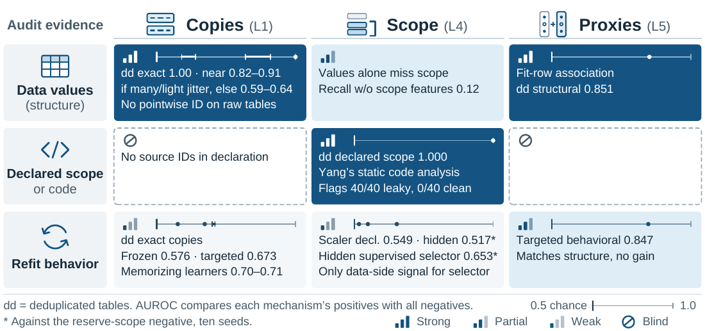
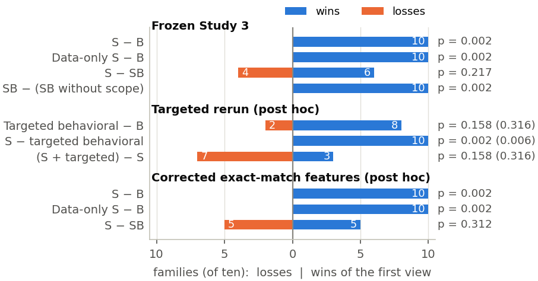
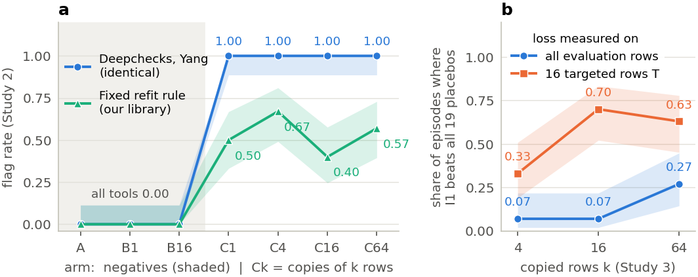
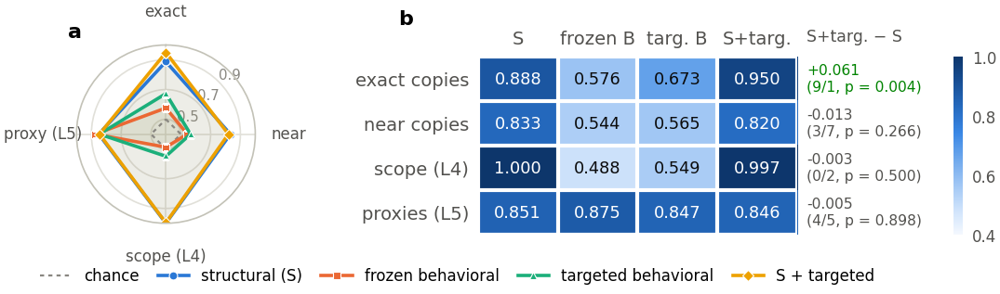
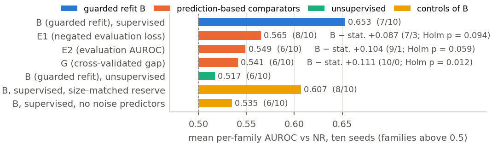
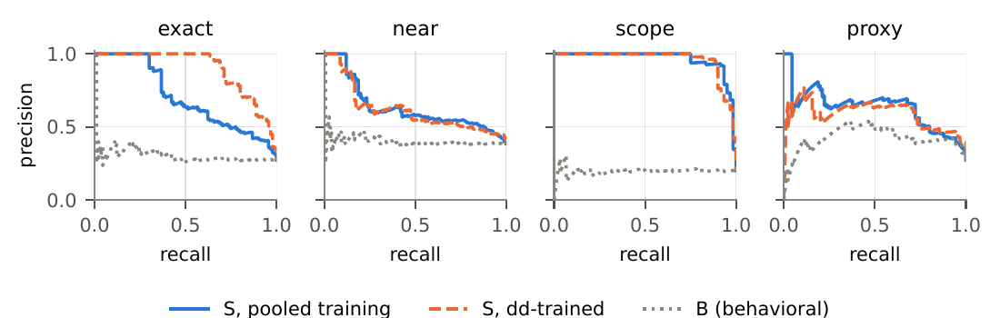

# What Detects Tabular Data Leakage?

**A controlled evaluation of structural, declared-scope and refit-based audits**


Code, frozen protocols and episode-level data for the paper *What Detects
Tabular Data Leakage? A Controlled Evaluation of Structural, Declared-Scope and
Refit-Based Audits* (under double-blind review; author names are withheld).

A leakage audit can read three kinds of evidence: the **structure** of the data,
the pipeline's **declared preprocessing scope** (or its code), or the pipeline's
**behavior** when it is refitted after a corrective edit. This repository holds
a reusable planted-leakage suite on ten public tables, implemented audits of all
three kinds, and every result needed to check the paper's numbers.

<p align="center">
  
</p>

<p align="center"><em>
What each evidence type reads (rows) for each planted mechanism (columns), with the AUROCs found.
Structure and declared scope carry the signal where the leak leaves a trace in them.
The refit audits are weaker, and are the only data-side signal for a hidden supervised scope.
</em></p>

> **Scope of the claims.** These are development results for the planted
> mechanisms and audit implementations evaluated here. All ten tables were
> inspected during development. The paper does not propose a new detector, does
> not claim that any detector is better than existing tools, and does not give a
> general ranking of evidence types.

## Contents

- [Main findings](#main-findings)
- [Repository layout](#repository-layout)
- [Installation](#installation)
- [Quick start](#quick-start)
- [The evaluation suite](#the-evaluation-suite)
- [Audits compared](#audits-compared)
- [Results](#results)
- [Reproducing the results](#reproducing-the-results)
- [Limitations](#limitations)
- [Citation](#citation)
- [License](#license)

## Main findings

| Question | Finding |
|---|---|
| Can values identify copied rows? | Only after deduplication. On raw tables 72.5% of negative episodes already contain an evaluation row with an equal fit row, so no rule that fires on a cross-split equality can separate planted copies from natural duplicates. |
| Structure or behavior? | The structural view beats the behavioral view in **all ten families**: mean per-family AUROC 0.857 against 0.610 (+0.247; sign-flip *p* = 0.002). Without the scope features it still wins in every family (+0.163). |
| Does strengthening behavior help? | Targeted rows, 19 placebos and memorizing learners raise the behavioral signal (0.610 to 0.642 to 0.661) but show no overall gain over structure. The one post hoc exception is deduplicated exact copies (+0.061, 9 of 10 families). |
| What if the scope is not declared? | A guarded refit gives a weak, confounded trace of supervised selection leakage (AUROC 0.653; 0.535 without added noise predictors) and none of scaling (0.517). Static program analysis flags all 40 tested leaky programs and none of the 40 clean ones. |
| Does the ranking hold elsewhere? | It holds with gradient-boosting and 1-NN audited learners and on nine unseen recipes planted in the same ten tables. This is within-panel robustness, not validation on new data. |

The comparison is conditioned on access. The structural and scope features
measure the planted quantities almost directly, while the frozen behavioral
edits correct only exact copies and a declared scope. The +0.247 ranks these
implemented views on this mixture of mechanisms; it is not an equal-access test.

## Repository layout

```
.
├── README.md
├── LICENSE                     # MIT (code), CC BY 4.0 (derived data and results)
├── CITATION.cff
├── pyproject.toml              # package and dependencies
├── environment.yml             # pinned versions used for the reported results
├── configs/                    # suite composition, container definitions, pointers to frozen protocols
├── src/leakagelens/            # refit-based audit library used by the runners
├── scripts/                    # data download, hash check, table rebuild, tabulation
├── notebooks/                  # results walkthrough and a toy demonstration
├── tests/                      # unit tests and consistency checks (nothing is fitted)
├── data/README.md              # data sources, preparation, hashes
├── results/                    # tables and figures as submitted, how to regenerate them
├── research/                   # per-experiment code, frozen protocols and saved outputs
├── docs/                       # datasheet, paper-to-code map, reproduction guide
└── .github/workflows/tests.yml # automated checks
```

`research/` keeps each experiment's code, frozen protocol and outputs together.
Its directory names carry dates and stage labels because the runners resolve
paths through them and the freeze hashes refer to them. See
[`docs/PAPER_MAP.md`](docs/PAPER_MAP.md) for the map from each section, table
and figure of the paper to its files.

## Installation

```bash
git clone <repository-url>
cd <repository>
conda env create --file environment.yml
conda activate leakagelens
pip install -e ".[dev]"
```

Python 3.10 or later. `environment.yml` pins the versions used for the reported
results (Python 3.12, numpy 2.3.3, pandas 2.5.3, scikit-learn 1.9.1). A plain
`pip install -e ".[dev]"` in any recent environment is enough for the checks
below. No GPU is needed anywhere.

## Quick start

Everything in this section reads saved files only. No model is fitted and no
dataset is downloaded.

**1. Check that the saved outputs reproduce the printed numbers**

```bash
pytest -q
```

This recomputes the per-family AUROCs of Table 2 from the saved out-of-fold
scores, reruns the matched-arm tabulation, rebuilds the robustness tables, and
compares each with the shipped files.

**2. Rebuild tables from saved results**

```bash
bash scripts/reproduce_tables.sh
```

**3. Read the results interactively**

```bash
pip install -e ".[notebooks]"
jupyter lab notebooks/
```

| Notebook | Content |
|---|---|
| [`01_results_walkthrough.ipynb`](notebooks/01_results_walkthrough.ipynb) | Recomputes the structure-versus-behavior comparison, the paired family-level test and the by-mechanism breakdown from saved scores. |
| [`02_structural_statistics_demo.ipynb`](notebooks/02_structural_statistics_demo.ipynb) | Plants copies, near copies and a leaky scope in a synthetic table and shows how the structural statistics and the `I1` edit respond. |

**4. Use the audit library**

```python
import numpy as np
from leakagelens.interventions import RuleConfig, SuspectedPipeline, apply_rule

pipeline = SuspectedPipeline(
    features=X, target=y,                       # pandas DataFrame and Series
    train_idx=train, validation_idx=np.array([], dtype=int), test_idx=test,
    preprocessor_fit_idx=train,                 # rows the preprocessing was fitted on
    model_family="logistic_regression", model_backend="sklearn", model_params={}, model_seed=0,
)
config = RuleConfig(proxy_screen_threshold=0.9, proxy_screen_bins=10,
                    placebo_row_fraction=0.05, placebo_seed_offset=1000)
edited, change = apply_rule(pipeline, "I1", config)   # remove training rows equal to a held-out row
print(change.rows_removed_from_training)
```

`SuspectedPipeline` holds only what an independent auditor could observe and
refuses any field that identifies an injection. The corrective edits and their
placebos are in [`src/leakagelens/interventions/`](src/leakagelens/interventions/).

## The evaluation suite

### Source tables

Ten public binary-classification tables, each kept as numeric predictors and
complete rows, in a **raw** and a **deduplicated (dd)** variant. The tables are
not redistributed; [`data/README.md`](data/README.md) explains how to obtain and
verify them.

| Family | Name | Predictors | Rows | Rows (dedup.) | Class-1 share |
|---|---|---:|---:|---:|---:|
| OpenML 1067 | kc1 | 21 | 2,109 | 1,192 | 0.15 |
| OpenML 1462 | banknote | 4 | 1,372 | 1,348 | 0.44 |
| OpenML 1464 | blood-transfusion | 4 | 748 | 502 | 0.76 |
| OpenML 1487 | ozone-level | 72 | 2,534 | 2,526 | 0.06 |
| OpenML 1489 | phoneme | 5 | 5,404 | 5,395 | 0.29 |
| OpenML 1494 | qsar-biodeg | 41 | 1,055 | 1,052 | 0.34 |
| OpenML 44 | spambase | 57 | 4,601 | 4,207 | 0.61 |
| UCI 159 | MAGIC gamma | 10 | 19,020 | 18,905 | 0.35 |
| UCI 329 | diabetic retinopathy | 19 | 1,151 | 1,146 | 0.53 |
| UCI 563 | Iranian churn | 13 | 3,150 | 2,836 | 0.16 |

Each table is split 75/25 (stratified) into training and evaluation rows. Ten
percent of the training rows are withheld as a **reserve** that is never fitted
or evaluated; it supplies the hardest negatives.

### Planted mechanisms and look-alikes

| | Arm | What is planted |
|---|---|---|
| **Positive** (13 arms) | `PE4`, `PE16`, `PE64` | exact copies of 4, 16 or 64 evaluation rows in the fit data (L1) |
| | `PJ16s01`, `PJ16s05`, `PJ16s20`, `PJ4s05`, `PJ64s05` | jittered copies, 4 to 64 rows, noise 0.01 to 0.20 column sd (L1) |
| | `PL4h`, `PL4f` | preprocessing scope containing half or all evaluation rows (L4) |
| | `PL5a80`, `PL5a95`, `PL5a995` | an added proxy predictor at univariate AUROC 0.80, 0.95 or 0.995 (L5) |
| **Negative** (8 arms) | `A` | clean |
| | `NB16`, `NJ16` | exact and jittered self-duplicates of 16 fit rows |
| | `NR16`, `NRJ16` | exact and jittered copies of 16 *reserve* rows |
| | `NL4R` | a scope of fit plus reserve rows |
| | `NL5S`, `NL5N` | a noisy copy of the strongest predictor; a noise predictor |

The main study has 1,260 episodes: 21 arms, ten families, two variants and three
seeds (780 positive, 480 negative). Two matched arms, a strength-matched proxy
and a strong legitimate predictor, bring the full set to 1,380. The composition
is indexed in [`configs/suite.yaml`](configs/suite.yaml) and documented in
[`docs/DATASHEET.md`](docs/DATASHEET.md).

### Ground truth

Truth is **ancestry**: a pipeline leaks if training and evaluation share source
records or, for scope and proxy leakage, if the planted flow is present. It is
computed from serialized source identifiers that no method sees, never from
value equality. An identical row with no shared source is not leakage, so
natural duplicates in raw tables are labeled negative.

## Audits compared

| Evidence | Reads | Statistic or edit (and its control) | Finds here / misses here |
|---|---|---|---|
| Copy structure | values, partitions | `exact_eval`: share of evaluation rows with an equal fit row; `excess_t`: share within *t·m* minus the fit-row leave-one-out share | dd exact copies (1.00), many or lightly jittered near copies; not raw-table ancestry, weak on few or heavily jittered copies |
| Association | values, labels (fit rows) | `assoc_top`: largest \|2·AUROC − 1\| over predictors, its gap and robust *z* | proxies; strong legitimate predictors are its hard look-alikes |
| Declared scope | scope row ids | `scope_eval_frac` = \|S ∩ E\| / \|E\| | L4 by construction; blind if the scope is not declared |
| Code | program | Yang et al.'s static data-flow analysis | every planted L4 program; needs the code |
| Frozen refit | recipe, predictions | `I1` removes fit rows equal to a held-out row vs. `P1` (as many random rows); `I4` refits preprocessing on fit rows vs. `P5` (drop a random predictor) | weak everywhere |
| Targeted refit | recipe, predictions | loss on the 16 evaluation rows nearest the fit set; nearest-row removal; top-predictor removal; each against 19 placebos (*z*) | exact copies and proxies alone; adds nothing to structure |
| Guarded refit | recipe, predictions | *B* = L(guarded) − L(suspected), preprocessing refitted on fit rows (hidden scope) | weak trace of supervised selection; none of scaling |
| C2ST | values, partitions | out-of-fold AUROC of a classifier separating fit from evaluation rows | poor copy detector (copies make the sets alike) |

Each learned **view** is an L2-regularized logistic regression over episode-level
features, evaluated by outer leave-one-family-out. Inside each fold the penalty,
a Platt calibration and a 10%-FPR threshold are chosen by inner
leave-one-family-out on the nine training families.

What each view can reach, by mechanism:

| View | Exact copies | Near copies | Scope (L4) | Proxies (L5) |
|---|---|---|---|---|
| Structural S (22 features) | feature<sup>a</sup> (`exact_eval`) | feature (`excess_t`) | feature (declared) | feature (`assoc_top`) |
| Data-only S (19) | feature<sup>a</sup> | feature | — | feature |
| Frozen behavioral B (8) | edit (`I1`) | — | edit (`I4`)<sup>b</sup> | — |
| Targeted behavioral (12)<sup>c</sup> | edit (`I1`, targeted rows) | edit (nearest row) | edit (`I4`)<sup>b</sup> | edit (top predictor) |

<sup>a</sup> Confounded by natural duplicates on raw tables. <sup>b</sup> Does not read the declaration. <sup>c</sup> Post hoc.

## Results

Results marked † are post hoc: each was run under its own later protocol and is
not part of the frozen primary analysis.

### Structure beats behavior in every family

Held-out-family AUROC by view. Each entry pools that family's 126 held-out
episodes (three seeds, raw and dd); the mean is over ten families, not 1,260
independent rows.

| View | 1067 | 1462 | 1464 | 1487 | 1489 | 1494 | 44 | UCI 159 | UCI 329 | UCI 563 | **Mean** |
|---|---:|---:|---:|---:|---:|---:|---:|---:|---:|---:|---:|
| S (structural) | 0.833 | 0.785 | 0.805 | 0.968 | 0.850 | 0.879 | 0.847 | 0.823 | 0.962 | 0.818 | **0.857** |
| B (behavioral) | 0.649 | 0.527 | 0.647 | 0.626 | 0.591 | 0.623 | 0.587 | 0.604 | 0.638 | 0.609 | **0.610** |
| SB (combined) | 0.827 | 0.658 | 0.788 | 0.952 | 0.854 | 0.898 | 0.782 | 0.837 | 0.963 | 0.814 | **0.837** |
| SB − scope | 0.782 | 0.579 | 0.735 | 0.893 | 0.791 | 0.819 | 0.694 | 0.741 | 0.895 | 0.731 | **0.766** |
| **S − B** | +0.184 | +0.258 | +0.158 | +0.342 | +0.259 | +0.256 | +0.260 | +0.219 | +0.324 | +0.209 | **+0.247** |

<p align="center">
  
</p>

<p align="center"><em>
Paired family-level comparisons of held-out-family AUROC: families (of ten) in which the first view wins or loses, with the exact sign-flip p.
For the targeted rerun†, Holm-adjusted values are in parentheses.
</em></p>

Combining behavior with structure shows no demonstrated overall gain: structure
alone is ahead by +0.020, with an interval (−0.012 to +0.051) compatible with a
small gain for the combined view. Nonsignificance is not read as equivalence.

### Refit responses miss copies that structure identifies

<p align="center">
  
</p>

<p align="center"><em>
Flag rates on deduplicated tables. (a) Study 2, 30 cells per entry: A, B1, B16 are negatives; Ck copies k evaluation rows.
(b) Share of Study-3 dd exact-copy episodes in which the I1 response exceeds all 19 placebos†, with the loss on all evaluation rows or on the 16 targeted rows.
Bands are Wilson 95% intervals.
</em></p>

Study 2 flag rates (420 cells):

| Variant | Tool | A | B1 | B16 | C1 | C4 | C16 | C64 |
|---|---|---:|---:|---:|---:|---:|---:|---:|
| dedup. | Deepchecks | 0.00 | 0.00 | 0.00 | 1.00 | 1.00 | 1.00 | 1.00 |
| dedup. | Yang (static analysis) | 0.00 | 0.00 | 0.00 | 1.00 | 1.00 | 1.00 | 1.00 |
| dedup. | Fixed refit rule | 0.00 | 0.00 | 0.00 | 0.50 | 0.67 | 0.40 | 0.57 |
| raw | Deepchecks | 0.97 | 0.97 | 0.97 | 1.00 | 1.00 | 1.00 | 1.00 |
| raw | Yang (static analysis) | 0.00 | 0.00 | 0.00 | 1.00 | 1.00 | 1.00 | 1.00 |
| raw | Fixed refit rule | 0.63 | 0.60 | 0.47 | 0.57 | 0.57 | 0.63 | 0.80 |

On deduplicated tables, data and code tools flag every copy and no negative.
The fixed refit rule flags 40 to 67% of positive cells. On raw tables a
value-equality check fires on 97% of negatives, because natural duplicates are
there before anything is planted. Two limits bound the Study-2 reading: its loss
is scored on odd evaluation positions, so C1's copied row is never scored, and
263 of the 420 emitted programs do not converge.

### By mechanism

<p align="center">
  
</p>

<p align="center"><em>
By mechanism on deduplicated tables: mean per-family AUROC of each view for one mechanism's positives against all negatives,
with the paired gain of adding the targeted features† to structure. Subgroup p values are post hoc and not adjusted for multiplicity.
</em></p>

| View (1,260 Study-3 episodes) | Per-family AUROC | TPR | FPR | Exact | Near | L4 | L5 |
|---|---:|---:|---:|---:|---:|---:|---:|
| Behavioral, frozen (8) | 0.610 | 0.11 | 0.09 | 0.12 | 0.10 | 0.10 | 0.11 |
| Targeted behavioral (12)† | 0.642 | 0.28 | 0.13 | 0.21 | 0.15 | 0.17 | 0.62 |
| Structural, corrected (22) | 0.857 | 0.40 | 0.10 | 0.42 | 0.26 | 0.94 | 0.24 |
| Structural + targeted behavioral (34)† | 0.841 | 0.48 | 0.13 | 0.49 | 0.28 | 0.79 | 0.60 |

The last four columns are recall by mechanism at each view's own pre-specified
threshold. Targeted behavior adds only on deduplicated exact copies and matches
structure on proxies without adding to it. At matched strength, the structural
view is not shown to tell a planted proxy from a legitimate predictor: it flags
2 of 60 strength-matched proxies and 7 of 60 strong legitimate predictors
(per-family AUROC 0.556, *p* = 0.58)†.

### Hidden scope

<p align="center">
  
</p>

<p align="center"><em>
Hidden (undeclared) scope at ten seeds†: positives (half or all evaluation rows in the scope) against the reserve-scope negative.
The guarded refit's trace is weak, depends on noise predictors selected with evaluation labels, and is absent for scaling.
Static analysis separates every tested program.
</em></p>

Any data-only statistic is identical across scope arms, because the arms differ
only in the pipeline's scope. With the scope hidden, the guarded refit ranks
supervised selection leakage above the negative with AUROC 0.653, above chance
in 7 of 10 families, which does not meet the pre-stated bar (AUROC ≥ 0.80 and
≥ 9 of 10 families). For a scaler it stays at chance (0.517).

### Robustness†

| Audited learner | Behav. AUROC | S − behav. (w/l; Holm *p*) | (S + behav.) − S (w/l; Holm *p*) |
|---|---:|---|---|
| *Stronger audited learner (1,260 Study-3 episodes)* | | | |
| gradient boosting | 0.653 | +0.205 (10/0; 0.008) | −0.011 (5/5; 0.781) |
| 1-NN | 0.661 | +0.196 (10/0; 0.008) | −0.035 (2/8; 0.180) |
| *Nine unseen recipes, detectors trained on the original arms (540 new episodes)* | | | |
| logistic regression | 0.614 | +0.197 (10/0; 0.004) | −0.013 (4/6; 0.422) |

On the unseen recipes the structural view's AUROC falls from 0.862 to 0.811,
just more than the pre-stated 0.05 margin, so transfer of the *learned* detector
is not shown. The scope feature itself still separates every new scope episode,
so a fixed rule transfers where learned weights do not.

### Operating points (oracle, descriptive)

Low-FPR recall is mechanism-specific. With thresholds set on the same dd
episodes (240 negatives, so 1% FPR is two false alarms), the structural view
recovers 75% of scope leaks, 30% of exact copies and 4% of proxies; behavior
recovers about 1%. These summarize discrimination and are **not validated
operating points**. The only thresholds set without the held-out family are the
pre-specified inner leave-one-family-out ones (nominal 10% FPR).

<p align="center">
  
</p>

<p align="center"><em>
Precision-recall curves on dd tables†, one mechanism's positives against all dd negatives.
Training on dd tables only mainly improves exact copies; behavior stays near the baseline everywhere.
</em></p>

All tables are in [`results/tables/`](results/tables/) and all figures in
[`results/figures/`](results/figures/).

## Reproducing the results

| Level | What it shows | Needs |
|---|---|---|
| **1. Check** | saved outputs are intact and give the printed numbers | this repository |
| **2. Rebuild** | tables regenerated from saved results | level 1; the source tables for some tables |
| **3. Refit** | episodes, features and detectors recomputed | source tables and a Slurm cluster |

```bash
pytest -q                               # level 1
python scripts/verify_manifest.py       # level 1: hash every file of research/
bash scripts/reproduce_tables.sh        # level 2
```

For level 3, prepare the data ([`data/README.md`](data/README.md)) and follow
[`docs/REPRODUCING.md`](docs/REPRODUCING.md). The fitted experiments were run as
Slurm array jobs; each `*.sbatch` under `research/` records its command line.
Every experiment has a protocol frozen before execution, with a recorded hash.

The fitted experiments have not been rerun from this repository layout, by the
authors or independently.

## Limitations

1. **Unequal access, by construction.** The structural and scope features
   measure the planted quantities almost directly, the declared scope defines
   L4, and the frozen behavioral edits reach two of four mechanisms. The ranking
   is of these views on these mechanisms, not of evidence types.
2. **No fresh data.** There are four kinds of evidence here: frozen primary
   results, post hoc analyses, unseen recipes on the *same* ten families, and
   external tools, of which only Deepchecks and Yang et al.'s tool were run
   themselves. All ten tables were inspected during development.
3. **Planted leakage, narrow behavioral coverage.** No natural leakage or
   notebook corpora; no entity (L2) or temporal (L3) leakage and no mixed
   types; three audited learners, one corrective repertoire and one guarded
   recipe.
4. **Small panel, oracle operating points.** Ten numeric binary tables and few
   negatives per family. The family-level tests describe this panel, not a
   population of tables.

The suite is suitable for comparing audit tools and types of audit evidence on
planted leakage. It is not evidence about how common natural leakage is, and it
is not confirmation data.

## Citation

The paper is under double-blind review. Until it is published, please cite it as:

```bibtex
@unpublished{leakage_audits_2026,
  title  = {What Detects Tabular Data Leakage? A Controlled Evaluation of
            Structural, Declared-Scope and Refit-Based Audits},
  author = {Anonymous},
  year   = {2026},
  note   = {Under review}
}
```

See also [`CITATION.cff`](CITATION.cff).

## License

- **Code** (`src/`, `scripts/`, `tests/`, `notebooks/`, and code under
  `research/`): [MIT](LICENSE).
- **Derived episode data, results, tables and figures:** CC BY 4.0.
- **Source tables:** not included; they remain under their repositories' terms.
  UCI 159, 329 and 563 are CC BY 4.0, and the OpenML tables are listed as
  "Public".

## Acknowledgments

The suite is built on tables from [OpenML](https://www.openml.org) and the
[UCI Machine Learning Repository](https://archive.ics.uci.edu). External
comparators are [Deepchecks](https://github.com/deepchecks/deepchecks) and the
static leakage analysis of Yang et al. (ASE 2022).
